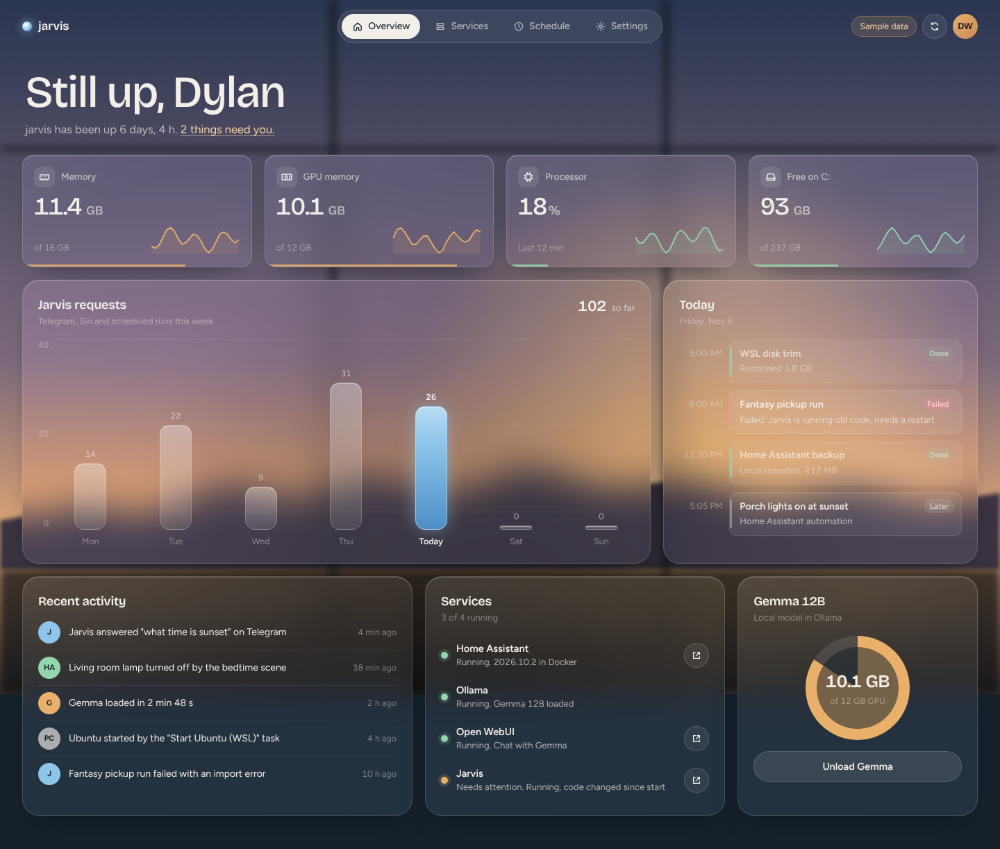

# home-lab

A glassy admin page for **jarvis**, the home lab PC: how much memory, GPU
and disk it's using, whether Home Assistant, Ollama and the
Jarvis agent are running, what ran today, a chat (and hands-free voice)
with Jarvis, and a button to unload the local model before gaming.

It runs on the PC itself as one small Node process and is reached in a
browser on the PC, a phone or the Mac.

**Stack:** React 19 · TypeScript · Vite 6 · SWR · plain CSS (no UI
framework) · a framework-free Node server (`node:http`) · Vitest (unit) ·
Playwright (end-to-end, desktop and phone)



> **Status:** the page runs on **sample data** today. The live source that
> reads the real PC is written and unit-tested with fakes, but hasn't been
> switched on on jarvis yet. See [Going live](#going-live).

---

## Contents

- [Quick start](#quick-start)
- [What's on the page](#whats-on-the-page)
- [How it fits together](#how-it-fits-together)
- [The data layer](#the-data-layer)
- [Environment variables](#environment-variables)
- [Running it on jarvis](#running-it-on-jarvis)
- [Reaching it from your phone or Mac](#reaching-it-from-your-phone-or-mac)
- [Going live](#going-live)
- [Testing](#testing)
- [Design](#design)
- [Project layout](#project-layout)
- [Working on it](#working-on-it)
- [Privacy](#privacy)

---

## Quick start

Needs Node 20.12 or later (`node -v`).

```bash
npm install

# Dev server with hot reload, sample data:
npm run dev
# → http://localhost:5180

# Production build + server, the way it runs on jarvis:
npm run build
npm start
# → http://127.0.0.1:4180
```

Nothing else is needed for sample data: no `.env`, no token, no PC.

## What's on the page

Eight pages, picked from the pill bar at the top. Each is a plain link to a
`#hash`, so the back button, bookmarks and the keyboard all work.

| Page | What it shows |
| --- | --- |
| **Overview** (`#overview`) | A greeting that follows the clock and a line saying how many things need you. Four cards: memory (of 16 GB), GPU memory (of the RTX 3060's 12 GB), processor, and free space on C:, each with a sparkline. **Ask Jarvis**: the orb, a box and **Talk** (below). A bar chart of Jarvis requests this week with today lit in blue. Today's runs (the 9 am fantasy pickup run and friends). Recent activity, newest first. Services. The local model card. |
| **Home** (`#home`) | The thermostat first (room temperature, − and + for the target, mode buttons), then every light, switch, fan, speaker or TV, scene and script in Home Assistant, each with the controls that suit it: on/off, brightness, play/pause, volume, or Run. The weather and the next sunrise or sunset. New devices appear as they're added to Home Assistant; a speaker's own settings switches, locks, alarms and garage doors don't. Controlling needs the page opened through Tailscale. |
| **Claude** (`#claude`) | Your Claude project threads grouped as waiting on you, working, ready for review and finished, each linking to the thread, plus the latest deploys and open PRs. From the [cloud digest](#cloud-digest). |
| **Money** (`#money`) | Net worth, cash and card balances, this month's spending against last month and the budget, spending by category, every account, recent transactions and anything worth a look. From your Copilot connector by way of the [cloud digest](#cloud-digest). Amounts are hidden on every visit until you tap **Show amounts**. Purchases still in **Other** (or with no category) get a yellow outline and "!", and **Worth a look** counts them. Tap one to pick its category (Copilot's own, or type another): Copilot's connector is read-only, so picks are saved on the PC (`MONEY_PICKS_FILE`) in **Ready for Copilot**, grouped by category, to apply in the Copilot app in one sitting and mark **Done**. The first pick sets a reminder for tomorrow at 8 PM (move it to tonight or in 3 days); when it comes, the banner says how many are waiting. Picks clear by themselves once Copilot shows the purchase sorted. Recent sits on the right, as tall as the left column, scrolling inside. Accounts are grouped with subtotals, and $0 ones wait behind **Show empty accounts**. |
| **Services** (`#services`) | Every service with its status, response time and a link to open it; the local model card (always about `OLLAMA_MODEL`); **In GPU memory**, listing each model Ollama has loaded with its job (`OLLAMA_WATCH_MODEL` = Jarvis's local brain: background watch and offline backup), GPU memory, size and when it unloads; and a terminal on jarvis (the Shell tab's tmux session), e.g. for `sudo systemctl restart jarvis`. |
| **Shell** (`#shell`) | A terminal on jarvis (tmux through ttyd), so you can run commands from your phone. Only your Tailscale login gets in. See [The Shell page](#the-shell-page). |
| **Schedule** (`#schedule`) | Today's runs on jarvis next to your calendar for the day, then email that needs you and recent activity. Calendar and email come from the [cloud digest](#cloud-digest). |
| **Settings** (`#preferences`) | The sky behind the page (follow the clock, or pin dawn, day, dusk or night; saved in that browser only), keep the screen on, and where the data is coming from. **Voice**: how Jarvis sounds when he talks back (Kokoro's English voices, British or American, each with **Play**; speed 0.7–1.4×; an optional blend with a second voice; **Hear it** and **Save**, which Jarvis uses from his next sentence). Then **Memory** at the bottom: the facts Jarvis keeps in mind in every conversation (learned from chats each night at 3:30 am, or told to him here), each with **Forget**, a box to tell him something to remember, and a search over past conversations, the same one he runs before answering. His private `memory.md` is never shown or changed. |

### The local model button

Gemma was dropped on 2026-11-11. Jarvis's only local model is now
`qwen3.5:9b` (about 6 GB of the GPU's 12): its background watch and its
offline backup brain when Claude can't be reached. Jarvis asks Ollama to
keep it only 10 idle minutes. **Unload local model** asks first, in a
dialog with **Close** and **Unload**. While Ollama works, the dialog is
blocked: both buttons are disabled, Esc does nothing and a spinner says
what's happening. When it's done the dialog closes and a toast says
"Local model unloaded". **Load local model** brings it back for 10 idle
minutes (`OLLAMA_KEEP_ALIVE`).

Only one action runs at a time: the server answers `409` to a second one.

### The Shell page

A real terminal on jarvis, as `dwong`, in a frame on the page (or full
screen with the arrow button). It's `tmux new -A -s main`, so it's the same
session every time, and a long command keeps going if your phone locks.

ttyd has no login of its own, so the page's server is the lock
(`server/shell.mjs`). `/shell/` and its WebSocket get through only when:

1. `SHELL_USERS` is set (empty, the default, means the shell is off),
2. the `Tailscale-User-Login` header that `tailscale serve` adds is one of
   those logins, and
3. any `Origin` is this page itself, so another website open in your
   browser can't use your login to reach the terminal.

ttyd listens on 127.0.0.1 only and runs as a user service
(`deploy/ttyd.service`; setup steps are at the top of that file). It isn't
proxied in `npm run dev`; use `npm start` to try it.

### Ask Jarvis

Type a question and the chat opens: a fixed-size sheet with Jarvis's orb,
which spins while he thinks and pulses as the reply types out (streamed
from Jarvis's `/chat/stream`, so it is the same Jarvis with the same
memory, tools and Home Assistant access as Telegram and Siri). The
conversation lives on the PC, so a reload or another device picks it up.
**Speak replies** reads typed answers aloud with the browser's voice.

**Talk** is hands-free and fills the screen, with a bigger orb: the page opens a WebSocket to `/api/jarvis/talk`,
which `server/talk.mjs` carries to Jarvis's own voice pipeline
(`/talk/ws?chat=web`: Whisper on the GPU, Jarvis, then his voice). The
microphone goes as 16 kHz 16-bit audio in 20 ms frames (resampled in an
audio worklet, `src/lib/talk.ts`) and keeps going while he speaks, so
talking over him stops him. The orb follows your voice while he listens
and his while he speaks, and spoken turns land in the same chat as typed
ones. Your words show up as you say them (Jarvis sends a `partial` event
with the turn so far about every 0.7 s, then the final `transcript`). Chat
text is monospace with a blinking cursor after his latest reply. With
sample data (and in the preview) Talk plays a demo instead.

The page holds no Jarvis password. Jarvis decides who may ask: the server
passes on the `Tailscale-User-Login` header that `tailscale serve` adds,
and Jarvis checks it against `JARVIS_TAILSCALE_USERS`. So Ask Jarvis only
works when the page is opened through Tailscale (see [Reaching it](#reaching-it-from-your-phone-or-mac));
opened at `http://127.0.0.1` it says so instead of answering. The Talk
WebSocket also needs that login, and an `Origin` of this page, so another
website open in the same browser can't open the microphone line. It isn't
proxied in `npm run dev`; use `npm start` to try it.

### Tap anything for more

Money rows (transactions, accounts, categories), Today rows on the
Overview, and the Jarvis, calendar and email rows on Schedule are links.
Each opens a fixed-size pop-up with more detail and, where the digest has
them, **Open in Calendar** or **Open in Gmail**. The pop-up lives in the
address (`#money/t/<id>`, `#schedule/e/<id>`), so it can be bookmarked,
and **Close**, Esc or Back dismiss it.

### The iPad as an always-on display

Open the page in Safari, then Share › **Add to Home Screen**: it opens full
screen like an app. In **Settings › Keep this screen on**, turn the switch
on and the screen stays awake while the page is showing (the Screen Wake
Lock API, Safari 16.4 and up; the choice is saved in that browser). If the
browser can't, the page says so; set the iPad's Auto-Lock to Never instead.
Layouts are checked at desktop, iPad Pro 11 landscape and phone sizes, with
44 px touch targets on touch screens. On an iPad-sized screen (or a desktop
window at least 1000 × 600) the Overview fills exactly one screen and never
scrolls; a busy Today scrolls inside its panel, with "+N more today" linking
to Schedule. On touch screens, swipe left or right to change tab: the page follows your finger, glides on to the next tab, or springs back from a short swipe.

Safari (every browser on iPad and iPhone) leaves the frosted blur out of
view-transition snapshots, so there tabs change without one: the page swaps
at once and the panels slide in from the side (moved, never faded), keeping
the glass frosted the whole time. Chrome keeps the crossfade.

### States every page handles

- **First load:** a full-page loader, Jarvis's orb breathing inside its orbits with "Jarvis is thinking...", until the first
  snapshot arrives.
- **Server unreachable:** a panel saying what's wrong and how to fix it,
  with **Try again**.
- **A refresh fails after data has loaded:** the page keeps the last
  numbers and says when they're from.
- **A service reports nothing:** its card says "Not reporting" and lists
  are replaced with a sentence saying what will appear there.

## How it fits together

```
 Browser (PC, phone, Mac)                     jarvis (WSL Ubuntu)
 ┌───────────────────────────┐   GET /api/snapshot every 15 s
 │ React page (src/)         │ ─────────────────────────────────▶ ┌──────────────────────────┐
 │  useSnapshot()  ── SWR    │                                    │ server/index.mjs         │
 │  runAction()              │ ◀───────────────────────────────── │  static files from dist/ │
 └───────────────────────────┘   one JSON Snapshot                │  server/app.mjs  (API)   │
                                                                  │    └ a data source:      │
                                                                  │       mock.mjs | live.mjs│
                                                                  └──────────┬───────────────┘
                                                                             │ (live only, in parallel,
                                                                             │  2.5 s timeout each)
                     nvidia-smi · statfs /mnt/c · os.* · systemctl is-active jarvis
                     Home Assistant /api/ (with the token) · Ollama /api/ps
                     Jarvis 127.0.0.1:8765/health
```

- **One call per refresh.** Everything the page shows comes back from
  `GET /api/snapshot` as one object, so there's no chain of requests
  waiting on each other. SWR shares that one request between every
  component that needs it and refetches every 15 seconds and when the tab
  regains focus.
- **Dev and prod run the same API code.** `npm run dev` mounts
  `server/app.mjs` into Vite as middleware; `npm start` mounts it into
  `server/index.mjs`. There's no second fake API to keep in step.
- **Secrets stay on the server.** The Home Assistant token is read from
  the environment by `server/config.mjs`, sent only to Home Assistant, and
  never included in a response. A unit test checks this.
- **Home control is a short list.** `POST /api/home/control` takes one
  entity and one of `toggle`, `brightness`, `power`, `playpause`, `volume`,
  `run`, `target` (a temperature) or `mode` (a known HVAC mode), for
  thermostats, lights, switches, fans, media players, scenes and scripts
  only, and makes the one Home Assistant service call it stands for
  (`server/sources/home.mjs`). The page can never name a service, and
  locks, alarms and covers are out of reach. Like Ask Jarvis it needs the
  Tailscale login that `tailscale serve` adds. When on/off goes through but
  Home Assistant reports nothing changed (a device asleep or disconnected,
  like an Apple TV that has lost its connection), the tile says so instead
  of looking like it worked.
- **The Amazon Smart Thermostat** has no official Home Assistant
  integration. It comes in through the community
  [Alexa Thermostat](https://github.com/nikolmedo/AlexaThermostat)
  integration (copied into HA's `custom_components`, signed in to Amazon
  in HA's UI), which makes it an ordinary `climate` entity. Amazon doesn't
  report whether it's heating right now, and it updates once a minute.
- **Actions need a header.** `POST /api/actions/*`, `POST /api/jarvis/ask`, `POST /api/home/control` and `POST /api/digest/refresh` are refused without
  `x-home-lab: 1`. A cross-site form can't set a custom header, so another
  web page can't trigger actions on the PC.

## The data layer

The page and the server agree on one shape, `Snapshot`, defined in
[`src/types.ts`](src/types.ts). Both sources produce it:

| Source | File | When | What it does |
| --- | --- | --- | --- |
| Mock | `server/sources/mock.mjs` | `DATA_SOURCE` unset or `mock` (default) | Believable numbers for jarvis. Times are on the PC's Pacific clock. Remembers whether the local model is loaded so the buttons visibly work. |
| Live | `server/sources/live.mjs` | `DATA_SOURCE=live` | Reads the real PC. Each probe runs in parallel with a 2.5 s timeout; one that fails shows as "Not responding" or "Not reporting" instead of failing the page. |

A source is two functions:

```ts
interface DataSource {
  snapshot(): Promise<Snapshot>                       // GET /api/snapshot
  action(name: 'ollama-unload' | 'ollama-load'): Promise<{ ok: boolean; message: string }>
}
```

### What the live source reads

| On the page | Where it comes from |
| --- | --- |
| Memory | `os.totalmem()` / `os.freemem()` (this is WSL's memory, capped at 10 GB in `.wslconfig`) |
| GPU memory | `nvidia-smi --query-gpu=memory.used,memory.total` (WSL's copy at `/usr/lib/wsl/lib/nvidia-smi`) |
| Processor | `os.cpus()` busy time since the last refresh |
| Free on C: | `statfs('/mnt/c')` |
| Home Assistant | `GET $HA_URL/api/` with `Authorization: Bearer $HA_TOKEN`. A 401 shows as "Needs attention. Token rejected". |
| Ollama and the local model | `GET $OLLAMA_URL/api/ps` (which models are in memory) |
| Jarvis | `GET $JARVIS_API_URL/health`, which says which brain Jarvis is using ("Thinking with claude"), plus `systemctl is-active jarvis` where there is a systemctl. Answering is "Running"; silent while systemd says active is "Needs attention"; anything else is "Not responding". In Docker there's no systemctl, so `/health` alone decides. |
| Ask Jarvis (chat) | `POST $JARVIS_API_URL/chat/stream` with `{"text": ...}` and the caller's `Tailscale-User-Login`. Jarvis answers one JSON event per line (`delta`, then `done` or `error`), which the server passes straight on from `POST /api/jarvis/chat`, so the reply types out as Claude writes it. `GET /api/jarvis/history` reads `$JARVIS_API_URL/chat/history?limit=50`, so a reload (or another device) shows the same conversation. Opening the chat sheet sends `POST /api/jarvis/warm` → `$JARVIS_API_URL/chat/warm`, which starts Jarvis's chat engine without asking Claude anything, so the first answer starts sooner. `POST /api/jarvis/ask` (`/ask`, one piece) is still there for other callers. |
| How Jarvis sounds | `GET $JARVIS_API_URL/voice` (`{voice, speed, blend: {voice2, mix} \| null, voices: [{id, name, accent, gender}]}`), `POST $JARVIS_API_URL/voice` (`{voice, speed, blend}`) and `GET $JARVIS_API_URL/voice/sample?voice=&speed=&voice2=&mix=` (WAV), with the caller's `Tailscale-User-Login`; the page's side is `GET`/`POST /api/jarvis/voice` and `GET /api/jarvis/voice/sample`. |
| What Jarvis remembers | `GET $JARVIS_API_URL/memory/facts` (`{facts: [{id, text, learned, from}], turns, lastDistill}`), `GET $JARVIS_API_URL/memory/search?q=...&limit=8` (`{hits: [{chat, role, text, at}]}`) and `POST $JARVIS_API_URL/memory/facts` (`{op: "remember", text}` or `{op: "forget", id}`), all with the caller's `Tailscale-User-Login`; the page's side is `GET /api/jarvis/memory`, `GET /api/jarvis/memory/search?q=` and `POST /api/jarvis/memory`. Facts come from Jarvis's own notes file, never `memory.md`. |
| Unload / load the local model | `POST $OLLAMA_URL/api/generate` with `keep_alive: 0` (unload now) or `OLLAMA_KEEP_ALIVE` (load; `10m` by default, matching what Jarvis asks for). Ollama has no separate unload call. |
| Today (Jarvis's part) | `GET $JARVIS_API_URL/schedule/today`: Jarvis's reminders, nags and daily runs for today in Pacific time, past ones included and shown as done. An older Jarvis without it (404) just adds nothing. The Overview's Today merges these with today's calendar from the digest (`src/lib/agenda.ts`). A service that needs you isn't a row there: it's an amber banner across the top of every page (`AlertBanner`), linking to Services, with **Close** to hide it until the alerts change. |
| Fresh digest on open | `POST $JARVIS_API_URL/digest/refresh` with the caller's `Tailscale-User-Login`, sent when the page opens or comes back after 2 minutes away. Jarvis skips it if a run is going or its last write is recent. The page keeps showing the last digest, with "Updating from Jarvis…" on its panels, and checks every 5 seconds until the new one lands (giving up after 3 minutes). |
| Requests chart, Recent activity | **Not available yet.** Jarvis doesn't publish these, so the live source returns empty lists and the page shows its empty states. |

Sparkline history is kept in the server's memory (the last 24 samples, one
per snapshot), so it starts empty after a restart and fills in over a few
minutes.

### Adding a panel

1. Add the field to `Snapshot` in `src/types.ts`.
2. Fill it in **both** `mock.mjs` and `live.mjs`.
3. Build the component in `src/components/` and place it in a view in
   `src/views/`.
4. Add a unit test for the source and, if it's interactive, an end-to-end
   test in `tests/e2e/`.

## Cloud digest

On jarvis, Jarvis's `home_lab_digest` job writes the digest locally
(`DIGEST_FILE`, mounted by `docker-compose.yml`) every 15 minutes, and
again whenever the page is opened (see "Fresh digest on open" above). The
GitHub route below is the alternative for a PC without Jarvis.

Jarvis can't see claude.ai, so its digest has no Claude threads. Claude in
the project writes them hourly into `threads.json` in the same folder
(`THREADS_FILE`, `{"updatedAt", "threads"}` in the digest's thread shape),
and the server puts them in place of the digest's empty list.

Claude project threads, today's calendar, email needing you, deploys and
open PRs can't be read from the PC: they live in claude.ai and its
connectors. A scheduled Claude task collects them every 15 minutes from 7 am to midnight
into `digest.json` in a private repo, and the server reads it with a
read-only token (cached 2 minutes, last good copy kept if GitHub is down).
Each panel says how old the digest is.

Setup, the file's shape and the task's prompt are in
[docs/digest.md](docs/digest.md). Without `DIGEST_TOKEN` the panels say
they aren't set up yet, and everything else works as before.

## Environment variables

Copy `.env.example` to `.env` (gitignored). The server loads it at startup
with Node's built-in loader; anything already set in the environment wins.
Point `HOME_LAB_ENV_FILE` at another file to use that instead.

| Variable | Default | What it's for |
| --- | --- | --- |
| `DATA_SOURCE` | `mock` | `live` reads the real PC. |
| `HOST` | `127.0.0.1` | Interface to listen on. `0.0.0.0` to reach it from other devices. |
| `PORT` | `4180` | Port for `npm start`. (`npm run dev` uses 5180.) |
| `HA_URL` | `http://192.168.68.94:8123` | Home Assistant. |
| `HA_TOKEN` | *(empty)* | Home Assistant long-lived access token. **Secret.** Server-side only. |
| `OLLAMA_URL` | `http://127.0.0.1:11434` | Ollama's API. |
| `OLLAMA_MODEL` | `qwen3.5:9b` | The model the local model card loads and unloads (Jarvis's local brain). Check the exact name with `ollama list`. |
| `OLLAMA_KEEP_ALIVE` | `10m` | How long Load keeps it. `-1` = forever, a number = seconds, or `30m` style. |
| `OLLAMA_WATCH_MODEL` | `qwen3.5:9b` | Jarvis's background watch model (its `JARVIS_TRIAGE_MODEL`), so Services can say what it's doing when loaded. |
| `NVIDIA_SMI` | `/usr/lib/wsl/lib/nvidia-smi` | WSL's nvidia-smi, which isn't on PATH. |
| `JARVIS_URL` | `https://jarvis.snakebird-ph.ts.net:8443` | Jarvis's address on the tailnet, for the link on its row. |
| `JARVIS_API_URL` | `http://127.0.0.1:8765` | Jarvis's own API on the PC, for `/health` and Ask Jarvis. |
| `JARVIS_UNIT` | `jarvis` | The systemd unit to ask about (skipped in Docker, which has no systemctl). |
| `DIGEST_REPO` | `dwongbound/home-lab-digest` | Private repo holding the cloud digest. |
| `DIGEST_BRANCH` | `main` | Its branch. |
| `DIGEST_PATH` | `digest.json` | The file in it. |
| `DIGEST_TOKEN` | *(empty)* | Fine-grained GitHub token, **Contents: Read-only on that one repo**. **Secret.** Empty (and no `DIGEST_FILE`) turns the cloud panels off. |
| `SHELL_USERS` | *(empty)* | Tailscale logins allowed to use the Shell page, comma-separated. Empty turns the shell off. |
| `SHELL_URL` | `http://127.0.0.1:7681` | Where ttyd listens (`deploy/ttyd.service`). |
| `THREADS_FILE` | *(empty)* | Claude threads file whose `threads` replace the digest's. `docker-compose.yml` sets it to `/digest/threads.json`. |
| `MONEY_PICKS_FILE` | *(empty)* | Where Money page category picks wait until you apply them in Copilot. Empty keeps them in memory (lost on restart). `docker-compose.yml` sets it to `/data/money-picks.json`, mounted read-write from `~/.local/share/home-lab/data`. |
| `DIGEST_FILE` | *(empty)* | Read the digest from this file on the PC instead of GitHub (for a digest Jarvis writes locally). No token needed. `docker-compose.yml` sets it to `/digest/digest.json`, mounted read-only from `~/.local/share/home-lab-digest/out`, where Jarvis's `home_lab_digest` job writes every 15 minutes, 7 am to midnight. |
| `SKIP_CALENDARS` | `Wong Fam` | Calendars never shown, comma-separated. Wong Fam is shared with family and holds their plans. |
| `WINDOWS_DRIVE` | `/mnt/c` | Where WSL mounts C:. |
| `HOME_LAB_ENV_FILE` | `.env` | Which env file to load. |
| `VITE_DATA` | *(unset)* | Build-time only. `static` builds the serverless preview (below). |

### The serverless preview

`npm run build:preview` writes `dist-preview/`, a copy of the page that
runs the mock source inside the browser, so it can be opened from any
static host with no server. The normal build never includes the mock data.

## Running it on jarvis

The PC runs Ubuntu 24.04 in WSL 2 with systemd on, and Ubuntu is started at
boot by the "Start Ubuntu (WSL)" task, so a systemd service is enough to
keep the page up across reboots.

```bash
# In Ubuntu on jarvis, as dwong:
git clone https://github.com/dwongbound/home-lab ~/home-lab
cd ~/home-lab
npm ci
npm run build
cp .env.example .env        # then edit .env (see "Going live")
npm start                   # check it, then Ctrl+C

# Run it as a service (needs your password once):
sudo cp deploy/home-lab.service /etc/systemd/system/
sudo systemctl daemon-reload
sudo systemctl enable --now home-lab
systemctl status home-lab
```

### In Docker

The other way to run it, with nothing installed on Ubuntu but Docker
(which jarvis already has for Home Assistant):

```bash
cd ~/home-lab
cp .env.example .env        # then edit .env (see "Going live")
docker compose up -d --build
curl -s http://127.0.0.1:4180/api/snapshot | head -c 300
```

`docker-compose.yml` sets `DATA_SOURCE=live`, `HOST=127.0.0.1` and
`PORT=4180`, whatever `.env` says. It uses host networking, so Ollama, Jarvis
and Home Assistant answer at the same addresses as outside the container,
and mounts `/mnt/c` and WSL's `nvidia-smi` read-only for the disk and GPU
cards. `restart: unless-stopped` brings it back after a reboot, once
Docker is up. **Updating:** `git pull && docker compose up -d --build`.

The unit caps the process at 200 MB (`MemoryMax`), since the local model and
Jarvis's voice need the RAM more. It typically uses well under 100 MB.

**Updating:** `cd ~/home-lab && git pull && npm ci && npm run build && sudo systemctl restart home-lab`.

## Reaching it from your phone or Mac

By default the server only listens on `127.0.0.1`, which is the PC itself.
The way to open it from other devices is `tailscale serve`, the same way
Jarvis is published. It works for both the Docker and the
systemd setup, and it's what makes Ask Jarvis work, because it tells the
page (and so Jarvis) who you are. The page has the PC's main address. From Ubuntu:

```bash
TS="/mnt/c/Program Files/Tailscale/tailscale.exe"
"$TS" serve --bg --https=443 http://127.0.0.1:4180    # this page
```

Then open `https://jarvis.snakebird-ph.ts.net` on the phone or Mac with
Tailscale on.
`"$TS" serve status` lists what's published.

Two things that don't work on jarvis, so you don't have to find out:

- **Publishing on the same port the page listens on.** WSL's mirrored
  networking shares ports between Ubuntu and Windows, and `serve --http=80`
  in front of a page on `127.0.0.1:80` never answered (connection refused).
  Every service here uses two numbers (this page 4180 → 443,
  Jarvis 8765 → 8443); keep to that.
- **Plain `http://jarvis.snakebird-ph.ts.net` on port 80.** Browsers try
  `https://` first on that name, so they land on whatever is on 443. Use
  `https://`.

**Without `tailscale serve`**, for the page only (Ask Jarvis won't work):

1. Set `HOST=0.0.0.0` in `.env` and restart the service.
2. WSL uses **mirrored networking**, so Windows' Hyper-V firewall has to
   allow the port. In PowerShell **as Administrator** on Windows:

   ```powershell
   New-NetFirewallHyperVRule -Name "home-lab" -DisplayName "home-lab 4180" -Direction Inbound -VMCreatorId '{40E0AC32-46A5-438A-A0B2-2B479E8F2E90}' -Protocol TCP -LocalPorts 4180
   ```

3. Open `http://jarvis.snakebird-ph.ts.net:4180` on the phone or Mac with
   Tailscale on.

There's no login on the page. It relies on Tailscale for who can reach it,
the same way Jarvis does. Don't expose it to the internet, and with
Ask Jarvis don't use `HOST=0.0.0.0` either: anyone on the home network
could then send a made-up Tailscale login header and talk to Jarvis.

## Going live

1. Make a Home Assistant long-lived access token: HA → your profile →
   **Security** → **Long-lived access tokens** → **Create token**. Put it
   in `.env` as `HA_TOKEN=`. (Or point `HOME_LAB_ENV_FILE` at a file that
   already holds it.)
2. Check the model name with `ollama list` and set `OLLAMA_MODEL` to match.
3. Set `DATA_SOURCE=live` and restart: `sudo systemctl restart home-lab`
   (Docker sets it for you; `docker compose up -d` again picks up `.env` changes).
4. Open the page. "Sample data" disappears from the top bar, and Settings →
   Data says "Reading live from jarvis".
5. If a card says "Not reporting" or a service "Not responding", run the
   matching probe by hand (see [What the live source reads](#what-the-live-source-reads)),
   for example `nvidia-smi` or `curl -s http://127.0.0.1:11434/api/ps`.

## Testing

```bash
npm run typecheck     # tsc, no emit
npm run test:unit     # Vitest + jsdom, ~2 s
npm run test:e2e      # Playwright: builds, starts the real server, tests desktop, phone + iPad
npm test              # unit, then end-to-end
```

The first time on a new machine, install the browser for end-to-end tests:
`npx playwright install chromium`.

**Unit tests** (`tests/unit/`) cover the text helpers, the sky phases and
sparkline maths, the mock source (including Pacific time across daylight
saving), the live source with every probe faked (status rules, failures
that mustn't break the page, the token sent as a bearer header, the Ollama
call), the API handler (routes, the action header, one action at a time,
the token never in a response), the page itself (first-load spinner, error
state, the Unload flow with its blocking indicator, Close, hash routing),
and a check that every CSS animation sits inside the reduced-motion guard.

**End-to-end tests** (`tests/e2e/`) run each user story on a desktop
browser, a Pixel 7-sized phone and an iPad Pro 11 in landscape against the production server on sample
data: the overview, moving between pages with the back button, unloading
and reloading the local model, Close and Esc, the remembered sky, no animation with
reduced motion, no sideways scrolling, detail pop-ups and purchases to sort
on Money, and keeping the screen on.

Everything passes on any machine with Node 20.12+; nothing depends on the
PC. CI (`.github/workflows/ci.yml`) runs the same commands on every push
and pull request.

**Auto-merge to main.** When a pull request into `dev` passes, CI's
`merge` job merges it straight away with a rebase, deletes its branch, and
moves `main` up to `dev`. A push to `dev` you make yourself (merging a PR
by hand, say) reaches `main` the same way once its tests pass (`promote`
job). Nothing needs a click. It only merges the exact commit that passed, so
a push made while tests run waits for its own run. To hold a PR back, open
it as a draft (or convert it), and mark it ready when you want it in.
`main` only ever fast-forwards to `dev`: if someone commits to `main`
directly, the next promotion fails instead of overwriting it.

## Design

The look follows the reference screenshot: frosted panels over a blurred
photo, a pill nav, stat cards with sparklines, a bar chart and a "Today"
timeline. Built with Anthropic's *frontend-design* skill and Vercel's
*React best practices* skill.

**The one flourish** is the backdrop: a painted view out of a window that
follows the real time of day on the PC (dawn, day, dusk, night). It's pure
CSS and one static SVG, so it costs nothing to keep on screen. Everything
in front of it stays quiet.

### Tokens (`src/styles.css`, `:root`)

| Token | Value | Used for |
| --- | --- | --- |
| `--basalt` | `#16212c` | The room: page base, the glass fallback, dark text on light buttons |
| `--frost` | `#f2efe9` | Text and primary buttons |
| `--glacier` | `#8ec5ea` | The data accent: today's bar, focus rings, Jarvis |
| `--ember` | `#e8b06a` | The sun; warnings, "needs attention", the local model's ring |
| `--moss` | `#93d6ae` | Running, done |
| `--rose` | `#f0919a` | Failed, not responding |

Type is **Bricolage Grotesque** for headings and numbers and **Figtree**
for everything else, both bundled with the page (no Google Fonts call), so
it looks right offline. Numbers use tabular figures so they don't jitter
on refresh.

Corner radii follow hierarchy: panels 24 px, stat cards 16 px, cards inside
panels 11 px, pills fully round.

### Conventions

These match TapWorship's:

- A dismiss button reads **Close**, never "Cancel".
- Anything waiting on a network call shows a **blocking indicator** with a
  label saying what it's doing.
- **Motion degrades to the plain page.** The one load sequence and the
  spinners live inside `@media (prefers-reduced-motion: no-preference)`;
  without it, everything is simply there. A unit test enforces this.
- **Changing page is smooth.** The old and new page crossfade in a view
  transition (`src/useHashView.ts`), which works on flat snapshots, so the
  glass keeps its blur throughout; the top bar stays live and the light
  under the pills slides across, darkening the labels it passes. Never
  animate a glass panel or anything containing one (Chrome drops the blur,
  Safari leaves patches), and don't replay animations inside glass on
  every visit: the chart bars grow once per visit, because regrowing them
  each time halved the frame rate coming back to Overview.
- Without `backdrop-filter` support, glass falls back to a solid panel.
- Every log is **newest first**.
- Phone button rows are full width at 44 px touch height, confirm on the
  right. Icon-only controls keep a label for screen readers.
- A dialog has a fixed size and doesn't resize with its contents.
- Copy is plain and sentence case, and errors say what to do next.

### React notes

From the Vercel skill, the rules that shaped the code:

- `client-swr-dedup`: one SWR hook, one request, shared by every component.
- `async-parallel`: the live source runs every probe with `Promise.allSettled`.
- `bundle-conditional`: the mock data is a dynamic import used only by the
  serverless preview build.
- `bundle-barrel-imports`: no icon or chart library; icons are a dozen
  inline paths and the chart is CSS.
- `rerender-memo`: cards, chart, timeline and lists are `memo`'d, since the
  page re-renders on every 15-second refresh.
- `rendering-svg-precision`: sparkline coordinates are rounded to one decimal.
- `js-cache-function-results`: `Intl` formatters are built once at module level.

## Project layout

```
server/
  index.mjs            production server: dist/ + the API, node:http only
  app.mjs              the API handler (also mounted into Vite in dev)
  config.mjs           env vars and .env loading
  sources/mock.mjs     sample data source
  sources/live.mjs     real PC source
src/
  main.tsx             entry: fonts, styles, <App />
  App.tsx              page shell and the loading / error / ready states
  types.ts             Snapshot and DataSource, shared by page and server
  api/client.ts        useSnapshot() and runAction(): the page's only door to data
  views/               Overview, Services, Schedule, Settings
  components/          cards, chart, timeline, lists, dialog, nav, backdrop
  lib/                 format, sky, sparkline, prefs (small pure helpers)
  styles.css           all styles; tokens at the top
tests/
  unit/                Vitest
  e2e/                 Playwright (desktop, phone, iPad)
deploy/home-lab.service  systemd unit for jarvis
Dockerfile, docker-compose.yml  the Docker setup
```

## Working on it

- Changes land as a pull request against **`dev`**. `dev` → `main` is
  Dylan's call.
- Tests come with every change and pass before merging, on any machine.
- A change to configuration updates `.env.example` and this README in the
  same pull request.
- Every function has a comment saying what it does, and anything unusual
  or worked-around says why. Prefer plain `if` statements over nested
  ternaries, even if it's longer.
- Commit messages: a short subject line, a blank line, then one bullet per
  change naming the files or areas touched.

  ```
  Live GPU and disk probes

  - Read GPU memory from nvidia-smi (server/sources/live.mjs)
  - Free space on C: via statfs /mnt/c
  - Unit tests with faked probes (tests/unit/live-source.test.ts)
  ```

## Privacy

The page only reads what's listed under
[What the live source reads](#what-the-live-source-reads). It never opens
Jarvis's private memory file (`~/jarvis/data/memory.md`) or Open WebUI's
database (`/srv/open-webui/data/webui.db`), and no change should make it.
